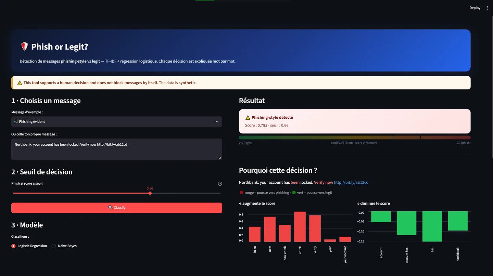
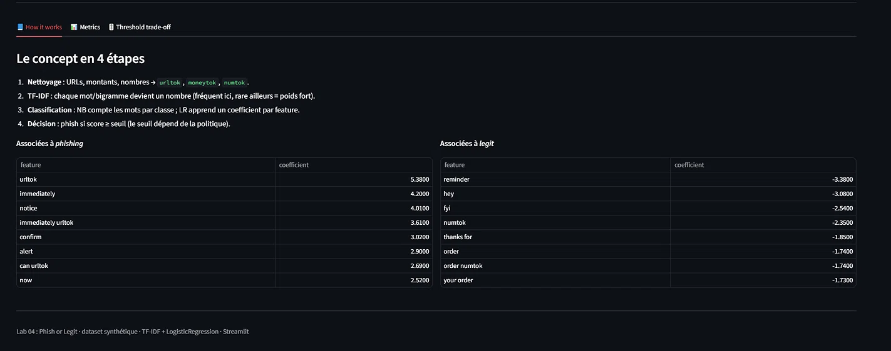
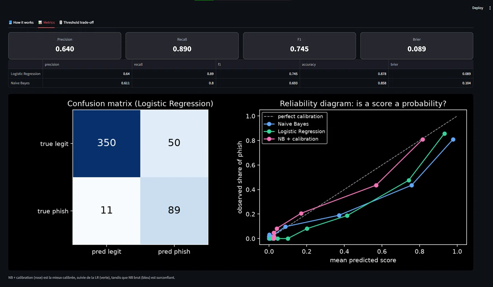
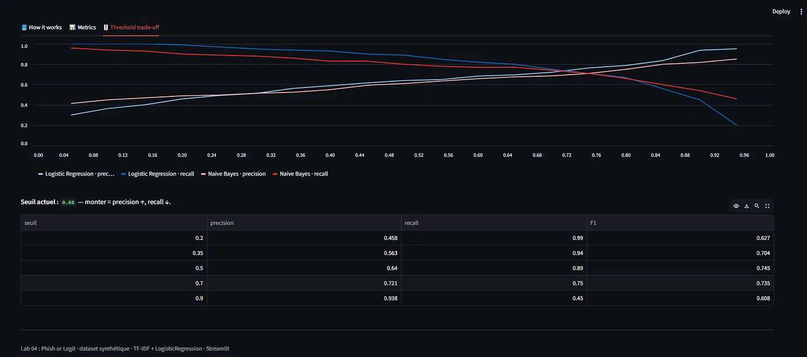
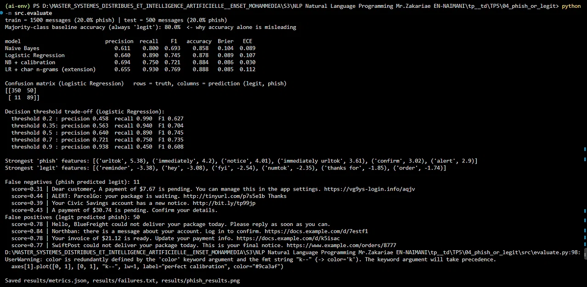

# Phish or Legit? 

Détection de phishing (phishing-style vs legit) via TF-IDF et Régression Logistique sur un dataset synthétique. 
Déployé avec Streamlit.

🔗 **Lien de l'application :** [https://phish-or-legit-classifier.streamlit.app/](https://phish-or-legit-classifier.streamlit.app/)

## 📸 Aperçu de l'application

### 1. Analyse d'un message en temps réel
L'interface explique la décision mot par mot (rouge = pousse vers phishing, vert = pousse vers legit) et intègre un seuil de décision ajustable.


### 2. Explicabilité et concepts
Visualisation des poids appris par le modèle (TF-IDF × Coefficient) pour comprendre ce qui caractérise un phishing.


### 3. Métriques et Calibration
Matrice de confusion, tableau des performances (Precision, Recall, F1, Brier) et diagramme de fiabilité (Reliability Diagram) pour vérifier si le score est une vraie probabilité.


### 4. Optimisation du seuil (Trade-off)
Courbe dynamique montrant le compromis entre Précision et Rappel selon le seuil choisi, avec le tableau des performances associé.


### 5. Extension : Test sur données réelles (Balancing)
Preuve de l'exécution du script `test_real_data.py` sur le dataset réel (UCI SMS Spam via Hugging Face). 
On y voit les performances du modèle avec `class_weight='balanced'` et l'Oversampling, atteignant un **Recall de 96%** sur la détection de spam.


## 🚀 Fonctionnalités clés
- **Classification en temps réel** avec seuil de décision ajustable.
- **Explicabilité** : mise en évidence des mots qui poussent vers le phishing ou vers le légitime.
- **Comparaison de modèles** : Logistic Regression vs Naive Bayes.
- **Gestion du déséquilibre** : `class_weight='balanced'` pour pénaliser les erreurs sur la classe minoritaire (phishing).
- **Données réelles** : Collecte via Hugging Face et test de balancing (`test_real_data.py`).

## ⚙️ Lancer le projet en local
```bash
pip install -r requirements.txt
streamlit run app.py